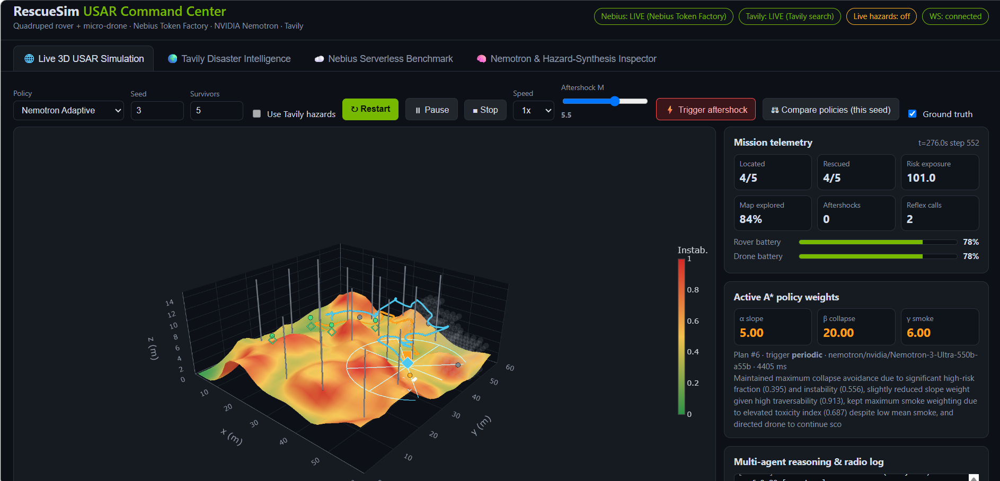

# RescueSim USAR

Multi-agent urban search-and-rescue simulator: a quadruped rover and a micro-drone search a collapsed building for survivors. Strategic planning uses NVIDIA Nemotron models on Nebius Token Factory, live hazard intelligence comes from Tavily, and a 100-episode policy benchmark runs as a Nebius Serverless Job.

Built for the Nebius x NVIDIA Global AI Hackathon 2026 (Physical AI track). License: Apache 2.0.



**Track:** Physical AI (software-only: all modules run in simulation). A quadruped rover and a micro-drone search a collapsed building for trapped survivors. Nemotron on Nebius Token Factory plans the rover's risk-aware routes and re-plans after aftershocks, a second Nemotron model rejects false heat signatures, and Tavily supplies live disaster data that changes the physics.

**Why it matters and what this is not:** rescuers entering a collapsed structure face the risk of secondary collapse, so sending robots in first to find survivors and safe routes is a natural use of autonomy. This project is a simulation testbed for comparing route-planning and decision policies before any hardware is involved. It has not been validated against real robots or real collapse sites, and its numbers describe the simulator only.

**Note on live mode:** with API keys set, the Nemotron reasoning models take several seconds per call (about 11 s for a reflex call), so a live mission runs slower than the offline one. Leave the keys out for a fast demo.

**Headline results** (100 paired episodes per policy, local run, offline planner; details below): the adaptive policy rescued 71.4% of survivors against 59.2% for greedy navigation (+12.2 points, Wilcoxon p = 0.0003) and lost robots in 20% of episodes against 30% (33% fewer, p = 0.033). The 60% loss-reduction goal was not reached.

**Try it in two minutes** (no API keys needed):

```bash
git clone https://github.com/roshini-t-24/rescuesim-usar.git && cd rescuesim-usar
pip install -r requirements.txt "uvicorn[standard]" python-dotenv
python server.py   # open http://localhost:8000, press "Start mission"
```

In the dashboard, "Compare policies (this seed)" runs all three policies on one seed, and the benchmark tab shows the 100-episode results.

## Architecture

```
Tavily search ──► PhysicalHazardModifiers ──► DisasterWorld (wind, smoke, instability, aftershocks)
                                                   │
        ┌──────────────────────────────────────────┤
        ▼                                          ▼
 MicroDrone (3D potential field)            QuadrupedRover (risk-aware A* + DWA)
  LiDAR + thermal scan                       acoustic TDOA array + payload pods
        └──────────► SharedMap / track fusion ◄────┘
                              │
          MissionCoordinator (Sense → Plan → Act)
                              │
     Nemotron planner (A* weights, task order)  +  Nemotron reflex agent (decoy vs survivor)
```

| Path | Role |
|---|---|
| `simulator/disaster_world.py` | 60×60×15 m collapse: elevation, instability, 3D smoke, pillars, survivors, heat decoys, wind, aftershocks |
| `simulator/sensors.py` | 36-ray LiDAR with Beer-Lambert attenuation, thermal SNR (inverse-square + smoke), acoustic TDOA array |
| `simulator/robot_kinematics.py` | Risk-aware A* (`C = d + α·slope + β·instability + γ·smoke`), DWA, 3D potential field, collapse-loss model |
| `agents/tavily_hazard_intel.py` | Runtime Tavily search → `PhysicalHazardModifiers` (LLM or regex extraction) |
| `agents/nemotron_orchestrator.py` | Planner + reflex clients for Nebius Token Factory, deterministic fallback |
| `agents/mission_coordinator.py` | Closed-loop state machine; policies `greedy`, `static`, `adaptive` |
| `nebius_jobs/` | Headless Monte Carlo evaluator + serverless job spec |
| `server.py`, `static/` | FastAPI REST + WebSocket backend and the 4-tab dashboard |

## How NVIDIA Nemotron, Nebius and Tavily are used

| Component | Model / service | What it does in the app |
|---|---|---|
| Strategic planner | `nvidia/Nemotron-3-Ultra-550b-a55b` on Nebius Token Factory | At mission start, after every aftershock, when a new survivor candidate appears, and periodically: reads the hazard modifiers and a world summary and returns the A* risk weights (slope, collapse, smoke), the rover's target order and the drone mode. Outputs are clamped to bounds in `config/settings.py` |
| Tactical reflex agent | `nvidia/NVIDIA-Nemotron-3-Nano-30B-A3B` on Nebius Token Factory | Classifies ambiguous thermal/acoustic contacts (survivor vs electrical or fire hotspot) before the rover commits to a route. Called only for mid-confidence contacts, at most 10 times per mission |
| Hazard extraction | Nemotron Ultra on Token Factory | Reads the retrieved web snippets and extracts physical hazard parameters; regex rules fill any parameter the model finds no evidence for (the dashboard labels this `nemotron+heuristic`) |
| Live hazard intelligence | Tavily Search API (runtime call) | Fetches current earthquake, structural and weather context for a user-chosen disaster zone. The extracted values change the physics engine: wind turbulence, ambient temperature and aftershock probability, which in turn change structural instability and the high-risk area (Tab 2 shows before/after) |

Token Factory notes: the endpoint is OpenAI-compatible (`https://api.studio.nebius.ai/v1/`). Both Nemotron models are reasoning models that spend completion tokens on thinking before the answer, so low `max_tokens` values returned empty content; the limits were raised (planner 2,500, extractor 6,000, reflex 1,200).

Not used: NVIDIA Cosmos model weights (hazard synthesis is procedural), Nebius Serverless Endpoints, and a deployed Nebius Serverless Job (see the jobs section). Every agent has a deterministic offline fallback, so the app also runs without keys.

## Run locally

Python 3.12 recommended.

```bash
python -m venv .venv
.venv\Scripts\activate          # Windows
pip install -r requirements.txt "uvicorn[standard]" python-dotenv httpx
copy .env.example .env          # keys optional
python server.py                # open http://localhost:8000
python -m pytest tests -q
```

With no keys the app runs fully offline (deterministic heuristic planner/reflex agent, cached hazard profile). The mode is shown in the header pills and the inspector tab.

## Nebius and NVIDIA setup

1. Create a Nebius Token Factory key and set `NEBIUS_API_KEY` in `.env`.
2. Open the Inspector tab and click **Check Nebius model catalog** (or `GET /api/models`). Set the planner and reflex model IDs to ones listed there; the defaults in `config/settings.py` returned 404 on the Token Factory endpoint during development.
3. Set `TAVILY_API_KEY` to enable live hazard search (Tab 2).

Live API paths (planner, reflex, Tavily extraction) were exercised only with fixture clients; verify them with your keys before relying on them.

## Nebius Serverless Jobs (prepared, not deployed)

The 100-episode benchmark is packaged as a container job: the `Dockerfile` runs `python -m nebius_jobs.batch_policy_eval`, and `nebius_jobs/deploy_job.sh` builds the image, pushes it to Nebius Container Registry and creates the job with the Nebius CLI (the CLI supports Ubuntu and macOS only). `nebius_jobs/job_spec.yaml` documents the settings.

The job was **not deployed**: the Nebius account used for development had no billing set up, and the platform rejected registry creation with `PermissionDenied`. All benchmark numbers below come from running the same module locally. The Nebius integration that was exercised is Token Factory (live Nemotron planner and reflex calls, see the live run section).

To deploy it yourself: set up billing, create a registry, then run `REGION=<region> REGISTRY_PATH=<registry-id-without-registry-prefix> ./nebius_jobs/deploy_job.sh` (add `DRY_RUN=1` first). The CPU platform and preset in the script are unverified defaults.

Run the same benchmark locally:

```bash
python -m nebius_jobs.batch_policy_eval --episodes 100 --output results/serverless_eval.json
```

## Benchmark results

100 paired episodes per policy (seeds 1000-1099), offline heuristic planner, collapse hazard rate 0.002 /s. Source: `results/serverless_eval.json`.

| Policy | Rescue rate | Robot loss | Mean time to first survivor | Wh per rescued |
|---|---|---|---|---|
| Greedy | 59.2% | 30.0% | 64.0 s | 74.4 |
| Static A* | 60.0% | 27.0% | 68.3 s | 72.5 |
| Adaptive | 71.4% | 20.0% | 62.1 s | 58.9 |

Adaptive vs greedy: +12.2 rescue points (Wilcoxon p = 0.0003), robot-loss reduction 33% (p = 0.033). Adaptive vs static: +11.4 points (p = 0.001), loss reduction 26% (p = 0.14, not significant). The >60% loss-reduction target is not met.

## Known limitations

- "Cosmos" hazard synthesis is procedural (Gaussian / Ornstein-Uhlenbeck fields); no NVIDIA Cosmos model weights are called.
- Benchmark numbers use the offline heuristic planner. Re-run with `--live` for Nemotron-driven results.
- The collapse-loss rate is a calibration constant. At 0.004 /s all three policies lose about 80% of episodes, so it cannot separate them.
- Route choice halves one-way trip risk but cannot remove the exposure of reaching survivors in unstable rubble.
## Live Nemotron run (exploratory)

20 paired episodes per policy (seeds 1000-1019) with live Nebius calls: planner `nvidia/Nemotron-3-Ultra-550b-a55b`, reflex `nvidia/NVIDIA-Nemotron-3-Nano-30B-A3B`. Source: `results/serverless_eval_live.json`.

| Policy | Rescue rate | Robot loss | Mean time to first survivor | Wh per rescued |
|---|---|---|---|---|
| Greedy | 61.0% | 35.0% | 55.5 s | 64.7 |
| Static A* | 52.0% | 45.0% | 62.4 s | 75.5 |
| Adaptive (live) | 60.0% | 30.0% | 67.2 s | 72.7 |

With only 20 episodes per policy the confidence intervals are wide, and the differences between policies are not statistically meaningful. The live planner mostly selected the maximum collapse weight, and one planner reply without JSON fell back to the heuristic. The 100-episode offline run above remains the primary result. Both reasoning models need roughly 1,200 to 2,500 completion tokens, so the token limits in `config/settings.py` were raised.
